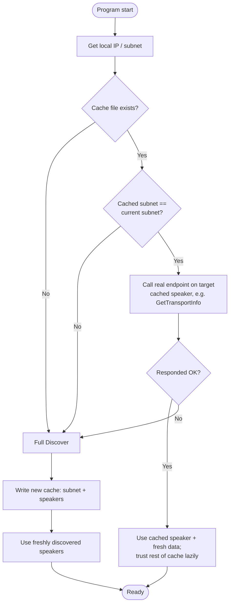

# 1. Identifying the network for a speaker cache

## Status

Accepted — implemented in `internal/sonos/cache.go` and wired into `cmd/sonos`.

## Context

`Discover` currently runs a full SSDP discovery burst (up to a few seconds) on every program invocation. We'd like to cache the speaker list between runs so the program can start up quickly, using the cache instead of a full discovery when it's likely still valid.

The open question: how does the program know its cached speaker list still applies? The instinctive approach is to identify "which network am I on" (e.g. by Wi-Fi SSID) and key the cache to that. Investigating this surfaced a real gap in Go's standard library and a better-fitting alternative, both captured here.

## Options considered

### 1. Read the Wi-Fi SSID

The most intuitive network identifier — but Go's standard library has no cross-platform way to read it. It requires OS-specific mechanisms:

- macOS: shell out to `networksetup -getairportnetwork en0`
- Linux: shell out to `iwgetid` / `nmcli`, or parse `/proc/net/wireless`
- Windows: shell out to `netsh wlan show interfaces`

**Rejected.** Every option is a subprocess dependency or CGo-adjacent, which conflicts with this project's established preference for pure Go, no CGo (the deciding factor in every library evaluation so far — `go-termimg`, `koron/go-ssdp`).

Surveyed the library landscape too, in case something solved this more cleanly than hand-rolling it: [mdlayher/wifi](https://pkg.go.dev/github.com/mdlayher/wifi) is the best-built option (MIT, pure Go via netlink, 74 importers) but Linux-only — doesn't run on macOS. [wifiscan](https://github.com/shadowypress/wifiscan) is cross-platform but shells out to the same OS utilities (`airport`/`iwlist`/`netsh.exe`) this option already rejected, and scans for *nearby* SSIDs rather than reporting the current connection cleanly. No library changes this option's conclusion.

### 2. Fingerprint the local subnet

`net.InterfaceAddrs()` gives the local IP and subnet mask with no CGo and no subprocess — `discovery.go`'s existing `getLocalIP()` already computes half of this. The subnet (e.g. `192.168.68.0/24`) could serve as an approximate cache key.

**Weakness:** many routers default to the same private ranges (`192.168.1.0/24` is extremely common), so two genuinely different networks can collide on this key. Cheap and pure Go, but only an approximate signal.

### 3. Fingerprint the default gateway's MAC address

A router's MAC address (read via the ARP table) is a stronger, more stable per-network identifier than the subnet. Hits the same wall as option 1, though: no stdlib API for reading the ARP table, so it also requires shelling out (`arp -a`) or OS-specific parsing.

**Rejected for the same reason as option 1**, unless the subnet fingerprint proves too collision-prone in practice. [jackpal/gateway](https://github.com/jackpal/gateway) (BSD-3-Clause, pure Go, no CGo, actively maintained, broad platform support) would remove the hand-rolling problem for the gateway *IP* specifically — but the MAC address, the stronger fingerprint, still has no clean library answer, so this option's rejection stands.

### 4. Validate the cache by reachability, not network identity

Reframes the question: instead of asking "which network am I on," ask "are the cached speakers still there." On startup, probe each cached speaker directly — a quick TCP dial to port 1400, or a short-timeout `GetTransportInfo()` call — instead of fingerprinting the network at all.

This is arguably more correct than any network-identity check: being on the same Wi-Fi as last time doesn't guarantee a speaker wasn't unplugged or given a new DHCP lease, and a reachability check catches that where a network fingerprint wouldn't. Uses only tools already in the codebase.

### 5. Combine subnet fingerprint + reachability check

Use the cheap subnet fingerprint (option 2) as a fast pre-filter — a different subnet than last time means don't even bother probing, go straight to full discovery. If the subnet matches, confirm with a reachability check (option 4) before trusting the cache. Falls back to full `Discover` if either check fails.

## Decision

Refining option 5, but reframed: the subnet fingerprint is a **speed optimization only**, not a correctness mechanism. A real call to a cached speaker is the only thing that actually proves the cache entry is still good — the network-identity options (1–3) were all just proxies for that question, so once we're willing to ask the speaker directly, none of them are needed as the source of truth. Option 3's library finding (`jackpal/gateway`) is noted above but isn't used by this decision.

The subnet mismatch and verification-failure paths both fall through to the same full `Discover` — the cache is never a hard dependency, only ever a shortcut around it.

### Resolved during implementation

**The rendering strategy was reversed.** This ADR, and the task as filed, both
specified the conservative order: verify, *then* render. That was reconsidered
against the goal of being ready as fast as possible, and the optimistic order
was chosen instead — read the cache, render every speaker immediately,
re-select the tab that was active at last exit, and run verification behind the
already-visible UI. The flow above still holds otherwise; it is only the point
at which tabs appear that moved.

The tradeoff accepted: for a second or two a tab may exist for a speaker that
has since gone. That is judged the right price, because the cache is usually
correct and the alternative is staring at an empty screen while every speaker
is probed.

**Verify all cached speakers, concurrently**, not just the one about to be
used. The "lazy" leaning recorded above assumed a single-speaker program;
`cmd/sonos` shows every speaker as a tab, so every tab needs proving. They are
independent network calls, so they run in parallel and the slowest one bounds
the total rather than the sum.

**Both checks are used, cheap one first.** `device_description.xml` is fetched
and its `UDN` compared against the cached SSDP `USN` before any SOAP call. This
catches a DHCP lease reassigned to a different device, which a reachability
check alone would call success. Measured against real hardware: a live speaker
verifies in ~73ms, a reassigned address is rejected in ~29ms, and a dead
address costs the full 2s timeout.

`DeviceDescription` gained a `UDN` field for this. The description fetched
during verification is also stored back onto the `Speaker`, so a room renamed
in the Sonos app updates its tab title without a second request.

**A failed speaker's tab is removed immediately**, including the active one.
Considered and rejected: keeping a failed active tab with an error line. The
simpler rule — the tab set always reflects reachable speakers — was preferred
over special-casing which tab you happen to be reading.

**Discovery always runs**, cache hit or not. Verification only proves the
speakers we already knew about; a speaker added since the cache was written
would never appear otherwise. Discovered speakers already on screen are
ignored, so the cache and discovery converge rather than duplicating.

**GENA subscription happens alongside verification**, not after it, so a
cache-started room is live as early as it is visible.

**The cache is written on exit only.** It records the speakers still on screen
and the USN of the selected tab. A crash or `kill -9` therefore loses it and
the next start pays full discovery — accepted deliberately, in exchange for a
single write at a single moment. Bubble Tea handles `q` and Ctrl+C gracefully,
so only hard kills are affected.

**Timeouts are hand-rolled, not context-threaded.** Verification uses its own
short-timeout `http.Client` rather than waiting on the work that threads
`context.Context` through the whole SOAP client. That refactor should not block
this feature, and the two calls here are the only ones needing a bound.

**Storage is JSON**, deliberately, not SQLite — see ADR-0003, which decided the
broader storage question separately. Migrating this cache onto
that store once it exists.

**The subnet fingerprint costs ~24µs**, measured. `GetLocalIP` was refactored to
share a single `net.InterfaceAddrs` call with the new `LocalSubnet`, so the
fingerprint added no second interface enumeration.

### Related, smaller optimization (no caching required)

Independent of this whole cache design: live measurements show `Discover` finds all speakers in well under 400ms, but its channel doesn't close until the full context deadline, since a straggler could still reply. A caller that only needs one speaker (e.g. `cmd/sonos/main.go`) could act on the *first* value received instead of draining the channel — a smaller, already-unlocked win from the streaming `Discover` design, worth doing regardless of whether the cache below is built.

## Consequences

The cache is a *fast path*, never a source of truth — `Discover` remains the fallback whenever the subnet check or the direct verification call fails. The cache file needs to store the subnet recorded at write time alongside the speaker list, so there's something to compare against on the next run. No decision here blocks other work; this document exists to record the reasoning so it doesn't need to be re-derived later.
