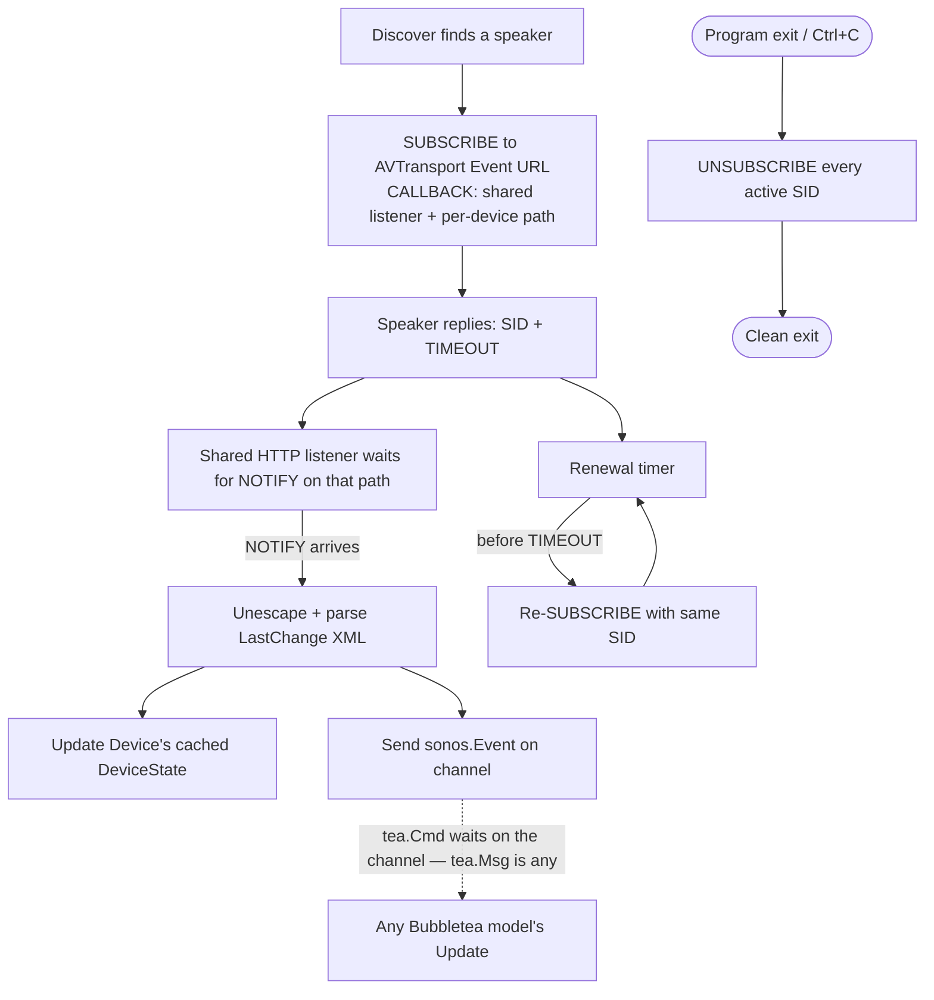

# 2. Subscribing to live speaker state via GENA eventing

## Status

Accepted — implemented in `internal/sonos` (`subscribe.go`, `eventlistener.go`, `eventmanager.go`, `Device.HandleEvent`/`Events`) and wired into `cmd/sonos`.

## Context

`Device` currently only learns a speaker's state by asking for it: `Refresh()` polls `GetTransportInfo`/`GetPositionInfo`, and `Play()`/`Pause()` optimistically guess the resulting state locally. Both are either stale (state drifts between polls) or approximate (a command might not actually take effect, and nothing notices).

UPnP defines an eventing mechanism for exactly this — **GENA** (General Event Notification Architecture), layered on plain HTTP:

1. `SUBSCRIBE` a service's event URL (e.g. a speaker's `/MediaRenderer/AVTransport/Event`), with a `CALLBACK` header pointing at a URL on *our* machine.
2. The speaker replies with a `SID` (subscription ID) and a `TIMEOUT`.
3. From then on, whenever relevant state changes, the speaker itself opens an HTTP connection back to our `CALLBACK` URL and sends a `NOTIFY`. The body is a `LastChange` element — XML, itself further-escaped like the DIDL-Lite metadata `GetPositionInfo` already unescapes — bundling *every* field that just changed into one push.
4. Before `TIMEOUT` elapses, a `SUBSCRIBE` carrying the same `SID` renews it, or the subscription silently lapses and `NOTIFY`s stop arriving.
5. `UNSUBSCRIBE` with the `SID` tells the speaker to stop calling us — being a "good citizen" means doing this on shutdown rather than leaving dangling subscriptions for the speaker to eventually time out on its own.

The part that matters architecturally: this makes our program an HTTP **server** as well as a client — the speaker calls back into us. Nothing in this codebase has needed an inbound HTTP surface before; `Discover`'s UDP listener is the closest existing precedent for "background goroutine owning a network resource."

Scope for this first pass is **AVTransport only** (play/pause/track-change state — the service that actually changes during normal listening). `RenderingControl` (volume/mute) is deliberately deferred: both services share identical GENA mechanics and a single bundled `LastChange` variable, so the subscribe/listen/renew plumbing built here is expected to be directly reusable — only the inner `LastChange` schema differs.

## Options considered

### Callback listener topology

One `http.Server` per `Device`, or one shared server for the whole process?

Per-`Device` means binding a port per subscribed speaker for no benefit — GENA's natural topology is one listener, many subscriptions, distinguished by path or `SID`.

**Decision: one shared listener**, started lazily on first subscription, with incoming `NOTIFY`s demuxed by a per-device path.

### Event delivery to calling code

How should a parsed event actually reach whatever's using `Device`?

- Transparently refresh `Device`'s existing cached `DeviceState` only — no new API surface, but silently loses the "something just changed" signal a reactive UI needs.
- Cache refresh **and** an explicit event channel.
- Channel only, dropping the cache — breaks every existing caller of `State()` for no reason.

**Decision: cache refresh and an event channel.** `Device` keeps updating `DeviceState` in place (same pattern as the existing optimistic update after `Play()`/`Pause()`), and separately exposes a receive-only channel of a plain, UI-framework-agnostic `sonos.Event`. Bubbletea defines `type Msg any`, so any concrete Go value already satisfies it — a small bridge goroutine can forward straight from this channel into a running `*tea.Program` via `Send(event)`, and a model's `Update()` type-switches on `sonos.Event` directly. No adapter/wrapper type needed, and `internal/sonos` never imports Bubbletea.

### Subscription renewal

Build automatic renewal now, or ship a single `SUBSCRIBE` that just expires (~30 min, typically) and revisit renewal later?

Deferring is less code today, but means the feature silently goes quiet a half hour in — a worse first experience than the modest cost of a renewal timer, and "revisit later" has a habit of not happening.

**Decision: build it now** — a timer that re-`SUBSCRIBE`s with the existing `SID` before `TIMEOUT` elapses.

### Service scope for v1

`AVTransport` only, `RenderingControl` only, or both together?

Both together doubles the `LastChange`-parsing surface before either is proven; `RenderingControl`-only skips the service that's actually dynamic during normal use.

**Decision: `AVTransport` only** (see Context) — `RenderingControl` is expected to be a small follow-on addition once this works.

## Decision

### `cmd/listening` — the verification harness

A new, deliberately simple command: discover every speaker on the LAN, subscribe to all of them, log every event to the console as it arrives (`log/slog` with [`lmittmann/tint`](https://github.com/lmittmann/tint) for human-readable, colorized output rather than raw JSON), and unsubscribe from everything on `Ctrl+C` before exiting. No interactive input in this first version — purely observational, run it and watch. This doubles as both the day-to-day development tool for building this feature and the natural shape for the `-live`-gated integration test (mirroring `discovery_test.go`/`ssdp_eval_test.go`), alongside `httptest`-based unit tests for the outbound `SUBSCRIBE`/renewal flow and the inbound listener (synthetic `NOTIFY` POSTs, no real speaker needed).

### Questions resolved during implementation

- **`sonos.Event` shape**: `{ Speaker, Transport TransportInfo, Current TrackMetadata, Raw AVTransportEvent }`. The two fields a UI almost always wants are lifted out; `Raw` keeps everything else the speaker sent (next track, queue source, play mode) so nothing parsed is thrown away.
- **Per-device path/key for the shared listener's demuxing**: per-device path, derived from a hash of `Speaker.USN` (raw USNs are long `uuid:RINCON_...::urn:...` strings, so they're hashed to keep callback URLs short and path-safe). Routing on path rather than the `SID` header means a renewal that changes the SID, or a late NOTIFY from a dropped subscription, can't be misattributed to another speaker.
- **Subscribe timing relative to discovery**: as each speaker streams in, confirming the leaning. Subscription happens in the same command that does a room's initial state fetch.
- **Shared listener bind address/port**: OS-assigned ephemeral port, bound in `newEventListener` before any `SUBSCRIBE` goes out, so the `CALLBACK` URL always names a resolved port.
- **Signal handling**: no bespoke handler was needed. Bubbletea installs its own `SIGINT`/`SIGTERM` handlers and returns from `Run()` on either, so `EventManager.Close` runs after `Run()` returns and covers `q`, `Ctrl+C` and `kill` alike.

Two decisions were revised against what this ADR originally sketched, both for shutdown safety:

- **Event delivery is a non-blocking send, not a blocking one.** `HandleEvent` runs on the listener's own request goroutine; a consumer that has stopped receiving (the UI shutting down) would wedge that goroutine and in turn stall `Shutdown`. State is applied before the send, so a dropped event costs a redraw, not correctness.
- **The bridge to Bubbletea is a `tea.Cmd` that waits on the channel, not a goroutine calling `program.Send`.** Equivalent in effect, but it avoids handing a `*tea.Program` to code that constructs the model, which is awkward given the program needs the model to exist first.

## Consequences

`internal/sonos` gains real new complexity: an inbound HTTP surface, background goroutines (per-subscription renewal, the shared listener), and shutdown/cleanup concerns that don't exist anywhere else in the codebase yet. `Device`'s public API grows (an events channel alongside `State()`/`Refresh()`/`Play()`/`Pause()`), but nothing existing has to change — polling via `Refresh()` keeps working exactly as today for callers that don't care about live updates. `RenderingControl` eventing, once wanted, is expected to be a small addition on top of this same machinery.
